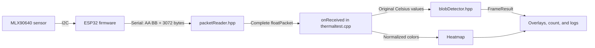

# Thermal Viewer: Code Structure

Our system counts separate warm regions, called **blobs**, in each 32 × 24 MLX90640 temperature frame. Sensor acquisition runs on the ESP32; blob detection and display run on the computer.

## Data flow



The detector uses the original temperatures. The heatmap rescales colors using each frame's minimum and maximum, so a red pixel is not a reliable detection criterion.

## Main source files and their roles

### 1. ESP32 firmware: acquiring temperatures

[`MLX90640_Thermal_Camera.ino`](MLX90640_Thermal_Camera/MLX90640_Thermal_Camera.ino) manages the sensor. `setup()` initializes I2C, loads sensor calibration parameters, and sets the refresh rate. `readTempValues()` collects both sensor subpages and calculates 768 Celsius temperatures. Only complete acquisitions are transmitted.

Each serial packet contains a two-byte `AA BB` header and 3072 temperature-data bytes, sent at 115200 baud. Blob detection happens on the computer, after reception.

The firmware uses three supporting components:

| Files | Role |
|---|---|
| [`MLX90640_API.cpp`](MLX90640_Thermal_Camera/MLX90640_API.cpp) / [`.h`](MLX90640_Thermal_Camera/MLX90640_API.h) | Reads sensor calibration/frame data and calculates Celsius temperatures. This is the sensor calculation layer. |
| [`MLX90640_I2C_Driver.cpp`](MLX90640_Thermal_Camera/MLX90640_I2C_Driver.cpp) / [`.h`](MLX90640_Thermal_Camera/MLX90640_I2C_Driver.h) | Reads and writes sensor registers through Arduino `Wire`. This is the hardware communication layer. |
| [`Thermal_Config.h`](MLX90640_Thermal_Camera/Thermal_Config.h) | Selects binary output (`THERMAL_DIAGNOSTIC_MODE=0`) or readable diagnostic output (`1`). The viewer requires binary mode. |

Sensor calibration converts measurements into temperatures. The separate background calibration described below learns the empty scene for blob detection.

### 2. Packet handling: reconstructing a complete frame

[`packetReader.hpp`](packetReader.hpp) reconstructs frames from serial bytes arriving in arbitrary chunks. Its state machine waits for `AA`, then `BB`, then collects exactly 3072 payload bytes. Only a complete packet triggers `onReceived()`, so partial serial reads never trigger detection. It also records reception counters for diagnostics.

[`floatPacket.hpp`](floatPacket.hpp) defines one payload with two views: `bytes[3072]` for reception and `data[768]` for temperature processing. Pixels use `index = row * 32 + column`, with `x = column` and `y = row`.

### 3. Blob detector: separating warm regions

[`blobDetector.hpp`](blobDetector.hpp) contains the C++17 detector. It is independent of SDL, serial, and OpenCV, allowing tests without hardware. The viewer calls `BlobDetector::processFrame()` once per complete packet.

Detection has four steps:

1. **Learn the empty background.** Collect 10 frames and calculate a median temperature for each pixel. Ignore NaN/Inf samples and require at least half the calibration frames, rounded up, to contain a valid sample. Freeze the background after calibration so a stationary warm region is not gradually absorbed.
2. **Create a foreground mask.** Inside the region of interest (ROI), select valid pixels where `currentTemperature - backgroundTemperature >= deltaThresholdC`.
3. **Separate connected regions.** Use breadth-first search (BFS) with eight neighbors, including diagonals. Discard components smaller than `minBlobArea`. No blur or morphology is applied.
4. **Describe each blob.** Record its frame-local label, pixel area, bounding box, mean/maximum Celsius temperature, and centroid. The centroid is the arithmetic mean of that blob's pixel coordinates, not a temperature-weighted position.

`FrameResult` groups the frame number, computer monotonic reception time, detection status, pixel-quality counts, and blob list. Reception time is **not the sensor capture time**. Labels identify components within one frame, not persistent people. `snapshot()` checks freshness without rerunning detection and hides old blobs after the timeout.

`DetectorConfig` centralizes the settings: 10 calibration frames, a 3.0°C difference threshold, a minimum area of 4 pixels, the full-frame ROI `{0, 0, 32, 24}`, and a 2000 ms stale timeout. These are experimental starting values; edit them and rebuild to tune detection. There is no absolute 37°C human-detection rule.

### 4. SDL viewer: displaying and reporting results

[`thermaltest.cpp`](thermaltest.cpp) is the computer application's entry point. `main()` opens the serial device, handles SDL events, reads incoming bytes, and renders the heatmap. `onReceived()` passes `packet.data` to the detector, prints frame/blob logs, and generates the heatmap colors.

`drawBlobOverlays()` draws white bounding boxes and red centroid crosses, mapping sensor coordinates to screen-cell centers. `updateDetectionTitle()` shows the current count and status. A new valid frame with no blobs immediately resets the count to zero.

Pressing **R** clears the background and previous results and starts calibration again. The viewer's `snapshot()` check marks data stale when no complete packet arrives for two seconds; incomplete payloads do not extend this timeout.

### 5. Tests and build

[`tests/blobDetector_test.cpp`](tests/blobDetector_test.cpp) checks synthetic empty scenes, one/two blobs, noise filtering, blob geometry/temperatures, invalid data, calibration, stationary blobs, ROI, stale data, and reset. It also verifies fragmented-packet handling and demonstrates that connected warm regions become one blob.

[`Makefile`](Makefile) builds the viewer with SDL2. Its detector tests need no SDL or hardware; `test-sanitize` adds AddressSanitizer and UndefinedBehaviorSanitizer.

## Running the system

From the repository root, with the existing macOS SDL2 or `sdl2-compat` environment:

```sh
cd thermal
make
./thermaltest /dev/cu.YOUR_DEVICE
```

Replace the device path with the ESP32 port and close Arduino Serial Monitor before opening the viewer. Keep the scene empty for the first 10 complete frames; detection starts on the next frame. Focus the viewer and press R to recalibrate in an empty scene.

```sh
make test
make test-sanitize
```

The window distinguishes a measured zero from unavailable data:

| Status | Meaning |
|---|---|
| `WAITING` | No complete packet received yet. |
| `CALIBRATING` | Collecting background samples; no detection count yet. |
| `READY` | Detection completed with fully usable input. |
| `DEGRADED` | Detection uses the remaining valid pixels after excluding invalid temperatures or missing ROI background values. |
| `INVALID` | No usable pixels in the ROI; no detection count. |
| `STALE` | No new complete frame within the timeout; old overlays are hidden. |

`READY` and `DEGRADED` show `Blobs: N`; other states show `Blobs: --`. During calibration, partial invalid data also adds a `DEGRADED` quality indicator. Terminal logs report each frame's count and excluded pixels, plus each blob's centroid, area, and temperatures.

## Limits and the related LiDAR code

**Blob count is not confirmed human count.** Touching people can form one blob, one person can produce several separated warm regions, and warm objects can also be detected. Hardware experiments should cover an empty scene, one stationary person, two separated people, two touching people, and a warm object.

The repository's [`lidar/direction_sensing.ino`](../lidar/direction_sensing.ino) uses one distance-weighted horizontal centroid across all detected cells to estimate movement direction and accumulate left/right counts. [`lidar/2LiDARs.ino`](../lidar/2LiDARs.ino) initializes two LiDAR sensors and prints their distance grids side by side. These are separate sketches; the thermal viewer does not currently consume their events or adjust their counts.

Future integration needs a shared observation area, an event-matching time window, and alignment between sensor time bases and transmission delays. The current thermal module supplies structured frame evidence; it does not estimate direction, track people, or count cumulative crossings.
